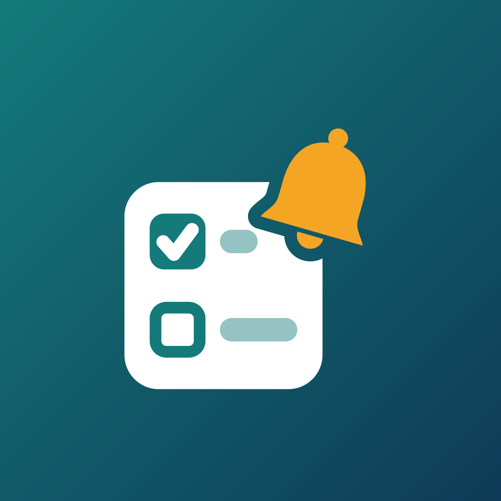

<p align="center">
  
</p>

<div dir="rtl">

# todo-bot

ربات تلگرامی کارها و یادآوری برای خودتان و خانواده، که روی سرور خودتان اجرا می‌شود.

[English](README.md) | فارسی

کارها را همان‌طور که می‌گویید می‌نویسید، مثلاً `buy milk tomorrow 18:00` یا `قرص هر روز ساعت ۹`. ربات فهرست را نگه می‌دارد، سر وقت یادآوری می‌کند و هر روز خلاصه‌ای از کارهای امروز و عقب‌افتاده می‌فرستد. ربات فارسی و انگلیسی بلد است و تاریخ‌ها را به تقویم میلادی یا شمسی (هجری شمسی) نشان می‌دهد.

## امکانات

- **فهرست کارها.** یک فهرست خصوصی در گفت‌وگوی شخصی شما با ربات، و یک فهرست مشترک جدا برای هر گروه.
- **متن ساده یعنی کار تازه.** در گفت‌وگوی خصوصی، هر پیامی که دستور نباشد به فهرست اضافه می‌شود.
- **تاریخ و زمان به زبان طبیعی.** مثل `فردا ساعت ۱۸`، `۲ ساعت دیگر`، `جمعه ساعت ۱۴:۳۰` و `۲۵ مهر`. عبارت‌های فارسی و انگلیسی هر دو فهمیده می‌شوند، حتی اگر زبان ربات را یکی از آن‌ها گذاشته باشید.
- **یادآوری.** هر کار با زمان، یادآور می‌شود. هنگام یادآوری دکمه‌هایی برای «انجام شد» و به‌تعویق‌انداختن می‌بینید.
- **کارهای تکرارشونده.** هر روز، روزهای کاری، هفتگی در روزهای دلخواه، ماهانه و هر N روز.
- **سپردن کار به دیگری.** با `/add @sara_home pick up our son today 15:00` (یا مثلاً `/add @sara_home بچه را از مدرسه بردار امروز ساعت ۱۵`) کار در همان گفت‌وگویی که نوشتید می‌ماند، ولی یادآوری‌هایش به گفت‌وگوی خصوصی همان شخص می‌رود. او باید @username تلگرام داشته باشد، یک بار در ربات دکمه Start (شروع) را بزند و شناسه‌اش در `TODO_ALLOWED_USERS` باشد. کسانی که پیش از این نسخه از ربات استفاده می‌کردند، پس از فرستادن پیام بعدی‌شان با نام کاربری شناخته می‌شوند. کارهای واگذارشده در `/list` او زیر عنوان «سپرده‌شده به من» دیده می‌شوند و هر دو نفر می‌توانند آن را انجام‌شده علامت بزنند. وقتی کسی که کار به او سپرده شده آن را انجام دهد، گفت‌وگویی که کار در آن نوشته شده پیام «انجام داد» می‌گیرد. اگر پیام دادن به او ممکن نباشد، یادآوری فقط یک بار به همان گفت‌وگویی که کار را در آن نوشتید فرستاده می‌شود. نکته درباره ساعت: `ساعت ۳` یعنی سه بامداد؛ برای بعدازظهر `ساعت ۱۵` یا `۳ بعدازظهر` بنویسید. جزئیات در [راهنمای استفاده](docs/USAGE.md#assigning-an-item-to-someone-add-username-text-when).
- **به‌تعویق‌انداختن.** ۱۰ دقیقه، ۱ ساعت یا فردا، از روی پیام یادآوری.
- **خلاصه روزانه.** کارهای عقب‌افتاده و امروز، در ساعتی که خودتان تعیین می‌کنید و برای هر گفت‌وگو جدا. دستور `/today` همان را در لحظه نشان می‌دهد.
- **فارسی و انگلیسی.** زبان هر کاربر جدا است. پاسخ فارسی با رقم فارسی نوشته می‌شود و رقم فارسی در ورودی هم پذیرفته می‌شود.
- **تقویم میلادی و شمسی.** تقویم هر کاربر جدا است و هم برای نمایش تاریخ و هم برای فهمیدن تاریخ‌های نوشته‌شده به کار می‌رود.
- **خصوصی.** فقط شناسه‌های کاربری داخل `TODO_ALLOWED_USERS` می‌توانند از ربات استفاده کنند.
- **آماده برای چند سرور.** یادآورها، دریافت پیام‌ها و پرسش‌های نیمه‌تمام از طریق پایگاه داده هماهنگ می‌شوند نه حافظه. بخش ۹ در [معماری](docs/ARCHITECTURE.md) را ببینید. نسخه ۰٫۱ روی یک سرور و با SQLite اجرا می‌شود.
- **سبک.** یک فایل اجرایی ایستا به زبان Go. به‌صورت سرویس systemd سخت‌سازی‌شده اجرا می‌شود، با سقف نرم ۴۰ مبی‌بایت برای Go (`GOMEMLIMIT`) و سقف سخت ۹۶ مگابایت (`MemoryMax`).

> جدول کامل تنظیم‌ها (متغیرهای محیطی) فقط در [README انگلیسی](README.md#configuration) است.

> در دست ساخت. پیشرفت کار: [docs/PROGRESS.md](docs/PROGRESS.md).

## شروع سریع

به یک سرور لینوکسی با systemd (یک VPS کوچک کافی است)، Go برای ساخت فایل اجرایی و یک حساب تلگرام نیاز دارید.

1. **ساخت ربات.** به [@BotFather](https://t.me/BotFather) بروید، `/newbot` را بفرستید و به پرسش‌ها پاسخ دهید. BotFather یک توکن شبیه `123456:ABC-...` می‌دهد. آن را محرمانه نگه دارید. سپس [تنظیم BotFather](#تنظیم-botfather) را کامل کنید.
2. **پیدا کردن شناسه کاربری.** ربات بدون `TODO_ALLOWED_USERS` راه‌اندازی نمی‌شود، پس اول باید شناسه عددی تلگرام خودتان را بدانید. یکی از این دو راه:
   - به یک ربات شناسه‌یاب خارجی مثل @userinfobot پیام بدهید تا شناسه‌تان را بگوید؛
   - یا با مقدار موقت (`TODO_ALLOWED_USERS=1`) نصب کنید، به ربات تازه‌تان پیام بدهید و `/whoami` را بفرستید. این دستور به افراد خارج از فهرست مجاز هم پاسخ می‌دهد و تنها دستوری است که چنین پاسخی دارد. سپس مقدار موقت را با شناسه‌ای که گرفتید عوض کنید و سرویس را دوباره راه بیندازید.

   وقتی ربات کار می‌کند، از هر عضو خانواده بخواهید `/whoami` را بفرستد و شناسه‌اش را به همان روش اضافه کنید.
3. **ساخت.** دستور `make build-linux` فایل `dist/todo-bot-linux-amd64` را می‌سازد. برای سرور ARM از `make build-linux ARCH=arm64` استفاده کنید.
4. **نصب.** اسکریپت `scripts/deploy.sh` روی **رایانه خودتان** اجرا می‌شود و با ssh/scp نصب می‌کند. مقدارهای پیش‌فرض `HOST` و `PORT` آن به سرور نگه‌دارنده پروژه اشاره می‌کنند، پس همیشه مقدار خودتان را بدهید:

<div dir="ltr">

   ```
   HOST=root@your.server PORT=22 scripts/deploy.sh bootstrap
   ```

</div>

   این دستور فایل اجرایی را می‌سازد و همراه با یونیت systemd کپی می‌کند، کاربر `todo-bot` را می‌سازد و اگر `/etc/todo-bot/env` وجود نداشته باشد، الگوی [`deploy/env.example`](deploy/env.example) را به‌جای آن می‌گذارد (مالک `root`، مجوز `0600`). تا وقتی توکن موقت عوض نشده، سرویس را راه نمی‌اندازد.
5. **پیکربندی.** روی سرور فایل `/etc/todo-bot/env` را ویرایش کنید و دست‌کم این دو مقدار را بگذارید:

<div dir="ltr">

   ```
   TELEGRAM_TOKEN=<token from BotFather>
   TODO_ALLOWED_USERS=11111,22222
   ```

</div>

   مقدار `TODO_ALLOWED_USERS` فهرست شناسه‌های مرحله ۲ است که با ویرگول جدا شده‌اند. جدول کامل تنظیم‌ها فقط به انگلیسی است: [Configuration در README انگلیسی](README.md#configuration).
6. **راه‌اندازی.** همان دستور `bootstrap` را دوباره اجرا کنید (یا روی سرور `systemctl enable --now todo-bot`) و سپس `scripts/deploy.sh status` و `logs` را بزنید. به‌روزرسانی، بازگشت به نسخه قبل و آزمون اولیه در [docs/DEPLOYMENT.md](docs/DEPLOYMENT.md) آمده است.
7. **سلام کنید.** `/start` را برای ربات بفرستید و سپس [docs/USAGE.md](docs/USAGE.md) را بخوانید.

> **هشدار: یک توکن، یک پردازش.** تلگرام اجازه می‌دهد برای هر توکن فقط یک پردازش پیام‌ها را دریافت کند. اگر ربات را روی لپ‌تاپ با توکن اصلی اجرا کنید، هر دو پردازش با خطای `409 Conflict` روبه‌رو می‌شوند و ربات اصلی دیگر پیامی نمی‌گیرد. برای توسعه با `/newbot` یک **ربات دوم** بسازید و توکن آن را به کار ببرید.

## تنظیم BotFather

این دستورها را به [@BotFather](https://t.me/BotFather) بفرستید و هر بار ربات خود را انتخاب کنید.

| مرحله | کار |
| --- | --- |
| `/newbot` | ساخت ربات و گرفتن توکن. |
| `/setuserpic` | فایل [`assets/icon-640.png`](assets/icon-640.png) را به‌عنوان تصویر ربات بفرستید. |
| `/setdescription` | متنی که هنگام باز کردن ربات برای اولین بار دیده می‌شود. |
| `/setcommands` | منوی دستورها. فهرست زیر را بچسبانید. |
| `/setjoingroups` | با `Enable` می‌توان ربات را به گروه افزود و با `Disable` ربات فقط در گفت‌وگوی خصوصی کار می‌کند. |
| `/setprivacy` | حالت حریم خصوصی را **روشن** (پیش‌فرض) نگه دارید. ربات فقط به دستورها و پاسخ‌ها به پیام‌های خودش نیاز دارد و این‌ها با حریم خصوصی روشن هم می‌رسند. |

ربات هنگام راه‌اندازی منوی خود را به فارسی و انگلیسی ثبت می‌کند، پس `/setcommands` اختیاری است. اگر دستی می‌گذارید، همین متن (که با منوی انگلیسی ربات یکی است) را بفرستید:

<div dir="ltr">

```
help - Show help
add - Add an item
list - Show open items
done - Mark an item done
del - Delete an item
edit - Change an item's text
today - Overdue and today's items
remind - Add a reminder to an item
tz - Set your time zone
digest - Set the daily digest
lang - Choose the language
calendar - Choose the calendar
```

</div>

دستورهای `/start` و `/whoami` کار می‌کنند ولی در منو نیستند.

## مستندات

- [راهنمای استفاده](docs/USAGE.md): همه دستورها با مثال فارسی و انگلیسی.
- [English README](README.md): شامل جدول کامل تنظیم‌ها.
- [استقرار](docs/DEPLOYMENT.md)
- [معماری](docs/ARCHITECTURE.md)
- [تاریخچه تغییرات](CHANGELOG.md)

## توسعه

برای ساخت و آزمایش، `make ci` همه کارهای CI را اجرا می‌کند (vet، lint، آزمون با `-race` و ساخت ایستای لینوکس). جزئیات در [README انگلیسی](README.md#development) و [CLAUDE.md](CLAUDE.md) است. برای توسعه حتماً از توکن یک ربات جدا استفاده کنید.

## پروانه

[MIT](LICENSE)

</div>
